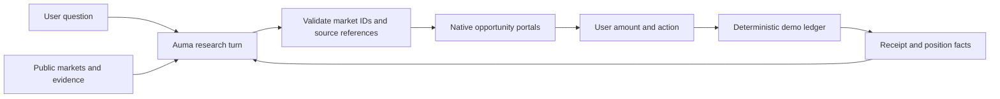

# Wolf native demo specification

Design record · 11 November 2026 · See WOLF_WEBSITE_INTEGRATION.md for the implemented state

**Owner correction, 11 November 2026:** Wolf is entirely a single app in the existing center pane. It never owns, replaces or duplicates Auma's chat. The resident Auma conversation stays in place and opens/updates Wolf through a host integration. Standalone preview renders only the Wolf center-pane surface. All two-lane/split-shell and separate-conversation requirements below are superseded by this correction; the financial and portal behavior remains applicable. The current integration handoff specifies the implemented single-pane contract.

## 1. The product decision

Build **one simple AUKORA workspace for exploring real prediction markets with demo money**. Auma researches on the left. Her validated findings appear as native market portals on the right. Open a portal, choose an outcome and an amount, try a position, then add to it or cash it out in the same place.

The first release should make this loop feel effortless:

**Ask → understand → open a portal → try a position → see what changed.**

It should look like an app that belongs in AUKORA.xyz on its first day. Use the actual Spatial components, header hierarchy, canvas, colors, spacing and disclosure behavior. Old Wolf UI contributes nothing to this surface.

The meaningful demonstration is that conversation, evidence, application state and recorded actions agree. Auma can explain a position using the same facts the position portal displays. A new finding creates a useful interface element. Every simulated action has an understandable record. This is the beginning of a finance app inside a shared intelligence system.

### Decisions for this version

| Decision | Specification |
| --- | --- |
| Launch form | Standalone Wolf app with its own entry point and local service; browser UI using actual Spatial components. Desktop packaging can wrap this same app later. |
| Later integration | The same Wolf surface mounts into AUKORA's existing shell and resident Auma conversation through a small host adapter. |
| Money | Start each demo account with **$1,000 demo cash**. No real balances, wallets, deposits or venue orders. |
| Market data | Public Polymarket discovery, market details and order books. Show live status only when freshness checks pass. |
| Research | Real provider-backed Auma with validated market tools when configured. Market browsing remains usable when research is unavailable. |
| Default screen | Auma left third; Wolf right two thirds. Two utility portals, then three real market portals. |
| Interaction | Details and amount controls expand in place. One clear final action records a simulation; no separate approval popup. |
| Primary actions | Try a position, Add more, Reduce, Cash out. |
| First market support | Verified binary market structures and supported protocol/fee/settlement mappings. Unsupported structures remain browse-only. |
| This deliverable | Specification only. No application was rebuilt, installed, activated or deployed during this review. |

The browser-first carrier is a delivery choice, not a claim that a web page is already installed inside AUKORA. “Native to AUKORA” means actual primitives, actual host registration, shared services and lifecycle behavior. Native-host delivery must later be observed in the running app.

## 2. The first screen

Use the existing **center-right-wide** Spatial preset. Keep the AUKORA corner navigation and lane geometry. Start directly in the conversation and Wolf surface rather than the website's public tour or thread picker.

```text
┌──────────────────────────┐ ┌──────────────────────────────────────────────┐
│ AUMA                     │ │ WOLF                                         │
│ RESEARCH AND EXPLAIN      │ │ LIVE MARKET DATA · DEMO MONEY                 │
│──────────────────────────│ │──────────────────────────────────────────────│
│ What would you like      │ │ [ Demo balance            + ] [ Your       + ]│
│ to explore?              │ │ [ $1,000 available          ] [ positions    ]│
│                          │ │                                              │
│ Find markets closing     │ │ [ Actual market question                  + ]│
│ this week                │ │ [ Outcome prices · source status            ]│
│                          │ │                                              │
│ Auma's short answer,     │ │ [ Actual market question                  − ]│
│ sources, and countercase │ │ [ Your holding or discovery summary         ]│
│                          │ │   Full question and brief resolution rule    │
│ “I found three matches.” │ │   Outcome: [ Yes ] [ No ]                    │
│                          │ │   Spend demo cash       [ $25             ]   │
│                          │ │   Quote · shares · costs · possible payout   │
│                          │ │   [ Try $25 on Yes ]                         │
│                          │ │                                              │
│ [ Ask Auma…            ] │ │ [ Actual market question                  + ]│
└──────────────────────────┘ └──────────────────────────────────────────────┘
```

This is a content map, not replacement CSS. Actual column wrapping follows the native PortalGrid. Preserve the website's reading width rather than stretching a form across all available space.

### Two permanent utility portals

**Demo balance** shows available demo cash, estimated position sell value and estimated total, each with correct labels. Reset lives inside this portal as an inline, deliberate action. “Start again with $1,000” creates a new account epoch and preserves the prior session's history.

**Your positions** shows owned outcomes using native compact records. Selecting a record opens its existing market portal. Activity is a disclosure inside Your positions, with understandable trade and settlement receipts. This avoids another permanent navigation surface.

Below those utilities, **each discovered market is its own portal**. Do not add an Opportunities gateway that users must open before seeing the actual markets. Begin with three supported results; “Show more” adds another batch. Auma's next search can add or revise portals without navigating away.

### Stable spatial behavior

- One main portal is expanded at a time. Its content opens inside the existing lane; the lane itself does not resize.
- Preserve the active market, scroll anchor, selected outcome and draft amount as results arrive. New findings cannot reorder the item under the user's pointer or steal focus.
- New findings enter the next stable slots and announce “3 markets added.” Held markets remain discoverable through Your positions even if hidden from the discovery list.
- A market has one portal regardless of how many times Auma finds it. Owning both outcomes creates two holdings inside that market, not two duplicate market portals.
- The portal head contains only its icon, title, summary and native plus/minus. Inputs and action buttons belong below it, never inside the head's HTML button.
- Closing a portal, changing lanes or navigating to another host app cannot discard an in-flight result or recorded position.

### What remains outside the first screen

Charts, strategy editors, agent swarms, model choices, receipt hashes and engine diagnostics belong in later or optional detail views. The first screen needs a conversation, a few understandable markets and a clear action. No ticker tape, chart wall, carousel, confetti, urgency prompts or invented “AI edge” score.

## 3. Exact design contract

The visual authority is the current **AUKORA.xyz** repository at `781f27adce475371eabd7aaf770aac4ee384c1ee`, especially its final `exact/spatial-template.css` overrides. The website freezes upstream components from `47056b9751a4f135876e2acb6c96caf8d84c3782`; that frozen reference and the current X6.1 checkout are different source versions.

| Element | Required appearance |
| --- | --- |
| Canvas | Exact layered dark Spatial canvas, including the native mint, blue and violet atmospheric gradients. |
| Frame | 10px exterior inset, 6px lane gaps, 22px lane corners. Existing corner controls. |
| Header | White title first, 24px, uppercase, weight 480, tracking .08em. Accent subtitle below, 11px/16px, with 6px separation. Native hairline and 20px left alignment. |
| Portal head | **68px fixed height**, 16px horizontal padding, 12px internal gap, 14px corner radius. |
| Portal spacing | **14px** between portals and body groups. |
| Icon tile | 30px tile with 16px glyph; use the native icon set. |
| Portal text | Title 15px/22px, weight 520; summary 13px/20px. Ellipsis in collapsed heads; full question visible on expansion. |
| Portal ring | Existing 1px tone ring and restrained native hover/open glow. |
| Main colors | Mint `#81D4B4`, blue `#96B4FF`, violet `#C4AAFF`, gold `#E0B76A`; text `#E8EAED`, secondary `#B8BCC4`, muted `#8B9099`. |
| Typography | Inherit the actual system-sans Spatial text token. Montserrat is a separate brand token; do not apply it to all UI. |
| Detail content | Native PortalDetail, FieldTable, RecordRow, fields and action groups. Preserve complete wrapping for rules and monetary descriptions. |

Use `PortalButton`, `PortalGrid`, `PortalCell`, `PortalDetail` and the native AppHeader. Retained content can use PortalFold where appropriate. Keep the data store outside their collapsible bodies: PortalButton and AppSurface can unmount children.

**Standalone:** reproduce the website's visual stylesheet order and necessary component dependency closure, without its public-preview behavior. **Embedded:** inherit the host shell/theme and scope Wolf's website-equivalent typography/geometry to its own surface. Do not restyle other AUKORA apps.

### Critical integration boundaries

1. Do not import the website's `exact/main.tsx` or `exact/isolation.ts` into Wolf. The preview isolation layer replaces/removes networking, storage and worker capabilities.
2. Do not import `presentation-chrome-core.mjs`. Its tour cleanup can hide “simulation,” “unavailable” and other status text that Wolf must keep visible.
3. Use one shell, one Wolf header and one set of corner controls. The embedded surface must not mount another AppFrame or resident conversation.
4. The website uses React 19.3.1; inspected X6.1 UI packages declare React 18.2 compatibility. The native bundle must use the host's React instance and appropriate adapter, not a bundled second renderer.
5. Keep “Demo money” and data status as normal visible content. Do not rely on the website's hidden passive-badge area.

### Mobile and accessibility

At **760px and below**, use the existing single-full-width-lane behavior and 44px corner controls to switch between Auma and Wolf. Preserve the draft and active market across the switch. Do not invent a separate drawer navigation or shrink desktop panes into columns.

Respect safe areas, software-keyboard viewport sizing and the existing 52px corner clearance. Keep all controls reachable at 320px width and 200% text zoom. Native disclosure controls retain `aria-expanded` and `aria-controls`; activating one keeps focus on its head, with normal tab order into its body. Async research does not move focus. Use labels as well as colors, reduced-motion behavior and throttled monetary announcements.

## 4. The first 90 seconds

1. **Arrive:** See Auma, $1,000 demo cash and three genuinely fetched markets. If data is unavailable, see that state instead of fabricated cards.
2. **Ask:** “Find markets closing this week.” Auma retrieves actual markets, explains why they match and adds three validated portals.
3. **Understand:** Open one. See the full question, named outcomes, close/status information and a brief explanation of what decides the result.
4. **Try:** Select an outcome, enter $25, inspect the inline quote and press **Try $25 on Yes**, using the actual outcome name. One simulated transaction updates cash, holding and activity together.
5. **Inspect:** The same portal now says “You hold Yes.” Its sell estimate can initially be lower than the purchase cost because of spread and fees; show that honestly.
6. **Adjust:** Choose Add more or Reduce. Cash out selects the whole remaining position and previews proceeds in place.
7. **Explain:** Ask “What changed in my position?” Auma reads the same account facts and observations as the portal. The receipt identifies the action as a simulated fill.

No extra approval ceremony belongs between the visible amount/action and the simulation. The inline preview is the review. If terms become invalid, refresh it and require the user to press the updated action; do not quietly change the trade under the original click.

## 5. Market portals and money behavior

### Collapsed market

Show the real question, supported outcome prices or status, and an ownership summary when held. “New” means newly discovered by this user, not newly profitable or newly listed. Use neutral relevance language such as “Matches your energy search.”

### Expanded market

The default reading order is:

1. Full question and concise rule summary, with a source link and closing/resolution status.
2. Exact outcome selector. Source outcomes are authoritative; Auma cannot rename them.
3. Current holding, if any, followed by Try/Add/Reduce/Cash out controls.
4. Amount input, live quote preview and one explicit action.
5. Optional “Why this market?” and “Details” disclosures containing supporting and opposing evidence, source timestamps, full rules, fees, shares and receipt history.

**Buy and Add:** the input means dollars of demo cash to spend, **including fees**. Provide $10, $25 and $50 presets plus custom input. Presets are conveniences, not recommended allocations. Invalid or unsupported sizes remain disabled with a reason.

**Reduce:** provide 25%, 50% and a custom share quantity. Freeze the resulting exact share quantity when quoting. Example copy: “Sell 25% · 18.3 shares → estimated $12.04 demo cash.” Do not treat 25% as a percentage of the original dollars invested.

**Cash out:** select all remaining shares and estimate net proceeds. This means selling the demo holding, not withdrawing to a bank. Desired-net-dollar selling is outside this first version; do not disguise share quantities as dollar inputs.

### Execution model

The paper engine buys against asks and sells against bids, walking available depth. It uses versioned fee rules and explicit rounding. A displayed midpoint or last price is contextual information, not a fill price. These distinctions follow Polymarket's current [price and order-book explanation](https://docs.polymarket.com/concepts/prices-orderbook).

The simulation executes the **full quoted share quantity or nothing**. If depth supports less, offer a smaller amount for the user to select. Do not silently partial-fill, invent liquidity, leave a resting order or create a background remainder.

A buy budget is a maximum debit. If valid share increments leave a small remainder, show the actual debit and leave the remainder in cash. Sell previews display net proceeds after modeled costs. No borrowing, leverage or short holdings.

Quote defaults are **10 seconds of local validity**, a book received no more than **5 seconds** before preview creation, and a fresh book/status read at commit. These are initial product settings, not venue guarantees. Preserve both upstream timestamps when supplied and local receipt time; an old venue timestamp alone does not prove an unchanged quiet book is unusable. A reconnect requires a fresh snapshot. Reject excessive clock skew or unverifiable continuity instead of refreshing a stale object's timestamp.

The preview binds account epoch/revision, market, protocol version, asset, side, exact shares, maximum debit or minimum proceeds, fee model, market-rules version, book observation and expiration. At commit, unchanged terms or an explicitly bounded improvement may execute; worse terms, changed outcome, insufficient funds or invalid market status return an updated preview with **no ledger change**. Never rebase a sell percentage against a changed holding.

### Honest amounts

| Label | Meaning |
| --- | --- |
| Available demo cash | Unspent simulated funds in this account epoch. |
| Total cost | Actual modeled purchase debit, including entry fees. |
| If this outcome wins | Conditional settlement payout for the quoted shares under supported rules, including the original stake component. |
| Maximum loss | For the supported fully funded position, the entire purchase debit can be lost. A tiny adverse price move is not the loss bound. |
| Estimated sell value | Current modeled net proceeds against bids for the held quantity. Display observation time. |
| Position change | Estimated sell value minus remaining cost basis. Label this unrealized. |
| Realized result | Net proceeds from completed simulated sales/settlements minus the basis allocated to them. |

Keep the first-action preview concise: actual debit, shares, costs, conditional payout and maximum loss. Detailed accounting stays in the disclosure and Your positions.

Use weighted-average cost basis consistently for this demo. Adding increases basis; a partial sale removes the proportional basis; full exit removes the exact remaining basis and any rounding remainder. Apply the supported protocol's declared quantity, fee and payout quantization rules at their specified calculation steps. Persist those exact results and any explicitly retained basis remainder; presentation rounding must never feed back into ledger calculations. Account totals must not double-count realized cash and position value.

If any holding lacks a reliable full-exit estimate, display an incomplete total with an explanation. Do not substitute zero or a midpoint and call the resulting figure cash-out value. Market estimates need not be synchronized to the same millisecond; preserve their ages and label the aggregate an estimate.

### Settlement

Trading closed, time expired, a news headline and a price near $1 are not final resolution. Settle only from supported final-resolution evidence and a verified payout vector, once per market/epoch. The adapter must handle an exceptional payout or retain “Awaiting supported resolution” rather than force every result into $1/$0. Polymarket documents both ordinary and exceptional resolution paths in its [resolution reference](https://docs.polymarket.com/concepts/resolution).

Auma explains resolution; she does not declare it or credit the account. Do not add a hidden production “force win” button to make the demonstration impressive. Recorded settlement examples belong in separately labelled test/demo fixtures.

## 6. Auma as a native app participant

Auma must be able to **discover, explain, compare, remember the research context and reveal validated opportunities**. Her output changes the useful workspace through typed events, rather than rendering arbitrary model-generated HTML.

### Research loop



1. Search the current market catalog using the user's topic and constraints.
2. Retrieve candidate details, rules and fresh observations. External reporting can add context; distinguish it from the market's resolution source.
3. Return a bounded, schema-constrained proposal: up to three real market IDs, relevance, evidence, countercase and invalidation conditions.
4. Validate all IDs, outcome mappings and cited source references against fetched records. The UI uses its own source title, prices and balances.
5. Save a research version and emit opportunity events. Existing portals update by identity; they do not duplicate.
6. Later explanations read saved research, new observations and actual ledger receipts. Auma can say what changed and what remains unknown.

Each proposal carries `authorizesOrder: false`. No phrase in a chat response can debit cash. The model's tools can read facts and propose portals; they cannot call the ledger commit capability. The user's explicit action in the portal supplies the simulated transaction intent.

### Useful initial prompts

- Find markets closing this week.
- Show markets about energy.
- Explain exactly what decides this market.
- What is the strongest argument against this outcome?
- What changed in my positions?

Avoid personalized allocations, guaranteed-return language and unvalidated confidence percentages. A market price is a market price; it is not Auma's measured probability. The first demo does not need a predictive model to explain facts well.

### Real chat integration

The current website Auma has a real text-provider path but reports `tools:false` and `conversationStorage:none`. It is not already connected to a portfolio or market-research tool loop. Its visual conversation components and cancellation pattern are useful; Wolf needs its own research orchestration.

Standalone Wolf uses a bounded persisted research session through its service and one configured provider initially. Keep credentials server-side. Do not call a paid model merely on launch; the first market list comes from public discovery. Stop cancels the active research request and prevents late output from changing another conversation.

When embedded, use AUKORA's existing resident Session/controller and model doors with narrow Wolf tools. Do not create a second invisible Auma session. The work/status bridge is not a substitute for the actual chat contract.

If the provider is unavailable, say “Auma couldn't finish that research.” Keep browsing, positions and deterministic explanations usable. A scripted demonstration may be a separately labelled guided mode, but must not impersonate live model reasoning or silently replace the live-data mode.

### Research budgets and data boundaries

Use bounded candidate counts, deadlines, cancellation and shared request budgets. Retrieved text is evidence, never authority to change tools, amounts or permissions. Keep model-visible context to the current question, relevant public evidence and necessary portfolio facts. Do not load the owner's entire personal memory into a demo for someone else.

Local research memory records why a market was surfaced, what the user asked and the cited evidence. Later host-memory integration should pass explicit, typed facts and corrections through a named adapter. An exported demo account or a shared research note does not implicitly include conversations, keys or personal history.

## 7. What X6.1 contributes

X6.1 makes the native direction more credible because it contains actual application primitives, model/session integration, versioned runtime machinery, receipts and bounded computation. These create a foundation for an inspectable finance workflow. They do not establish profitable prediction or an already complete trading system.

Source review began at `132d8e346e11481796d0198e9d6f1ea0deed798b`. Independent work advanced the checkout during review; the newer cell inspection is pinned to `24f65e81e8029f9e33efda871833300ab1c00630`. Neither pin identifies the currently installed application.

| Existing source | Concrete Wolf use | Work still required |
| --- | --- | --- |
| Spatial primitives, app slots and pane presets | Identical portals/header; one surface usable standalone and inside the host. | Wolf surface, component dependency closure, scoped styles and host adapter. |
| Resident sessions, model doors and bounded consult | Auma uses the same conversational context and provider controls as other native apps. | Market tools, research schema, validated events and portfolio fact adapter. |
| Memory/recall and correction patterns | Preserve research rationale, source changes and user preferences. | Defined Wolf records, privacy/export rules and tested host-memory mapping. |
| Receipt/checkpoint and content-addressed source machinery | Bind an explanation to the exact data/rule/version used; retain inspectable history. | Financial journal, quote retention and explicit receipt mapping. A signature does not make input facts true. |
| Scion compilation and candidate comparison | Later compare a proposed research or rule module against recorded cases before adopting it. | Financial evaluation datasets, unseen-period checks and admission policy. Existing checks do not measure investment edge. |
| Admitted Wasm cell host and skillsmith | Run a small, deterministic Wolf accounting/invariant checker with identified inputs and code. | The actual financial cell and differential tests. |
| Owner-governed publication and custody | Keep app/module updates and protected runtime changes under the real owner route. | Trading-specific authority rules if real money is ever added. Current governance is not a blanket trading permission. |
| Nostr-related identity/provenance cells | Later share attributed research or portable evidence across people/agents. | A deliberate transport, disclosure and verification integration. No assumption of an active relay or financial order network. |

### The newer Wasm opportunity, accurately stated

At the newer reviewed source pin, **24 cells** are registered; older Round 37 prose says 23. The added skillsmith route can compile/meter a bounded pure guest and identify the resulting bytes. None of the registered cells is a ready-made portfolio, pricing, market-risk or reconciliation engine.

Useful distinctions:

- `risk-signature` and kernel risk checks classify operational actions, not investment risk.
- `grant-ledger` accounts for permission spending, not dollars or shares.
- `aura-relay` provides history/admission/replay patterns; it does not establish that a venue report is true.
- `goal-receipts` binds workflow scope and digests; it does not grant a market order.
- Laya supplies shadow evaluation/replay patterns; it is not financial inference.

The worthwhile first Wolf-specific cell would check a proposed transition: **cash stays nonnegative; sold quantity is owned; fee and position deltas conserve value under the stated model; account/quote versions agree; replay gives the same answer.** Send bounded fixed-point facts, never floating-point currency. Keep durable transaction ownership in the Wolf service.

Start that cell as a shadow check against the authoritative deterministic ledger. Record and flag disagreements without changing balances or transaction admission. The ledger's own validated invariants remain authoritative. Promote the cell to enforcement only after source identity, host behavior and differential coverage are established.

The reviewed skillsmith guest path has a 1 MiB memory maximum and a 10 million fuel maximum. Those guest limits differ from the host's broader pinned-cell limits and do not establish containment for arbitrary JavaScript candidates. The point is bounded, repeatable checking, not a universal safety claim.

### The path beyond the demo

The durable product advantage could be the closed loop: **evidence → proposal → controlled action → observed result → remembered correction → evaluated improvement**. Conventional chat glued to a trading API usually leaves those pieces disconnected. AUKORA has relevant machinery to connect them, but Wolf must implement and prove that connection.

Later autonomous paper trading should use one explicit mandate with limits, expiry and stop behavior. Deterministic checks then govern each action without a human popup per trade. The current source still reports no working closed-tab executor; continuous operation needs a real running service and observed recovery behavior.

Kronos, Dexter, Jev and other research/execution components can become interchangeable providers behind the same contracts if they prove useful. None is a prerequisite for the first honest demo, and including more repositories is not evidence of better returns. Keep model research outside the quote/commit path. Local fast checks cannot remove venue latency, spread or liquidity constraints.

## 8. Architecture that survives standalone and native use

Build one domain implementation and one visual surface. Change the carrier and host adapters, not the meaning of a position or transaction.

```text
Standalone carrier                    Later AUKORA host
one Spatial shell                     existing shell and resident Auma
standalone conversation adapter        native session/tool adapter
             \                        /
              same Wolf surface and state contracts
                           |
                    versioned Wolf service
       public market broker · research · quotes · durable demo ledger
                           |
              optional pure-check / host-memory adapters
```

### Proposed source organization

| Package | Ownership |
| --- | --- |
| `apps/desk` | Standalone entry, native shell composition and startup. |
| `apps/service` | Same-origin API, public feeds, research jobs and transactional persistence. |
| `packages/wolf-ui` | Shared Wolf surface and retained presentation store. |
| `packages/wolf-core` | Schemas, fixed-precision arithmetic, quote rules, ledger reducer and invariants. |
| `packages/spatial-ui` | Minimal pinned component/icon/style dependency closure with original notices. |
| `packages/aukora-adapter` | Surface/menu registration, resident session, host services and cleanup. |

These paths are proposed, not existing completed modules. Keep the new implementation separate from the old paper UI while preserving unrelated work.

### Service and persistence

For the first standalone build, one local service serves UI/API from one origin and owns SQLite. Persist accounts/epochs, holdings/basis, operation results, immutable journal events, observations referenced by receipts, research jobs/sources and portal identities. Browser storage owns presentation convenience, not the authoritative financial balance. Responsive checks initially use different viewports in the same app instance; actual phone access or cross-device sharing requires an explicitly configured reachable service and account transport.

An accepted transaction writes the operation result, cash, holdings, journal and account revision atomically. Unique operation IDs and expected revisions protect retries and concurrent windows. Reusing an ID with different terms is an error. After an uncertain transport response, query that operation's result before offering a new action.

Protect mutation routes with the service's local session capability and origin checks. This is a demo service, not an exchange signer. It has no route that submits a venue order, transfers funds or turns `DEMO` into live money. Keep provider secrets out of the UI, exports and logs.

The future native adapter registers through `shell.surface`, `shell.menu.apps` and the existing layout service. It injects a compatible Wolf service client and uses the resident session. Mounting a component does not create its backend. Filesystem writes do not substitute for transaction guarantees.

For cloud-native deployment, choose an actual hosted transactional store/service behind the same contract. A cloud Worker cannot use a database on the owner's Mac. One account must have one canonical writer; do not create independently mutable standalone and host copies. Import/export is explicit, versioned and validated.

### Common service contract

The following are proposed domain operations, not claims about existing X6 APIs:

| Operation | Contract |
| --- | --- |
| `capabilities` | Mode DEMO; supported market/protocol versions; current data and research availability; source/model identities. |
| `searchMarkets`, `market`, `book` | Typed public data with source, stable IDs, lifecycle, observation time and unsupported reasons. |
| `startResearch`, `cancelResearch` | Bounded cancellable jobs, persisted status and validated result references. |
| `opportunities` | Versioned proposals referring to real markets and cited source records. |
| `portfolio`, `activity` | Authoritative demo state and understandable immutable receipts. |
| `preview` | Immutable short-lived modeled quote from an amount/quantity intent. |
| `commitDemo` | Quote ID, operation ID and expected account revision; returns one durable simulated result or a typed refusal. |
| `operation` | Resolve pending/unknown submission status without resubmitting. |
| `resetDemo` | Explicit new account epoch and $1,000 funding event; reject old quotes. |
| `events` | Monotonic sequence and entity version; reconnect can request an authoritative snapshot. |

### Essential records

- **Market:** venue, event ID, market/condition ID, protocol version, exact question, outcomes with opaque asset IDs, rules/version, lifecycle, source link and timestamps.
- **Book observation:** immutable ID/digest, asset, decimal price/size levels, source/received times, tick/minimum constraints with explicit units, fee metadata reference and continuity/freshness state.
- **Opportunity:** market identity, originating turn/job, rationale, supporting/opposing sources, observation time, expiry/invalidation, status and `authorizesOrder:false`.
- **Quote:** account epoch/revision, market/asset/version, intent, exact modeled quantity, costs, bounds, fees, observations and expiry.
- **Receipt:** operation/quote IDs, simulation-model version, exact deltas, allocated basis, observations, timestamp and resulting account revision. It says “Simulated fill,” never “Confirmed on Polymarket.”

Prices, quantities and money use decimal strings or integer units with declared scales. Do not send values beyond safe integer bounds into Wasm JSON as JavaScript numbers. Retain source observations required to replay a receipt independently of normal cache expiry.

## 9. Public Polymarket integration

Use a fixed-destination, read-only broker for approved Polymarket endpoints. No arbitrary URL proxy. Discovery pagination, event grouping and outcome mapping belong in the adapter, not in chat text.

Current documentation provides the unified `@polymarket/client` public client and distinguishes CTF/v1 token IDs from v2 position IDs. Normalize them as an opaque, version-aware `assetId`; preserve the version. The existing Wolf parser only reads `clobTokenIds` and needs replacement or a deliberate compatibility adapter. See [market discovery](https://docs.polymarket.com/market-data/discover-markets) and [order-book data](https://docs.polymarket.com/market-data/prices-order-books).

At implementation, pin a tested SDK version and real response fixtures. Validate every book level; explicitly sort normalized bids/asks rather than assume index zero is best. Minimum-size units and fee conventions must be confirmed for each supported protocol; inconsistent or missing metadata makes trading unavailable for that market.

Read market-specific fee metadata and version the calculation. Unknown is not zero. Do not hard-code a universal percentage from a fee table. See [market fee fields](https://docs.polymarket.com/market-data/market-details) and [fee rules](https://docs.polymarket.com/trading/fees).

Start with bounded discovery refresh and faster reads only for visible/held assets. A public market subscription can reduce latency; snapshot/delta reconciliation, reconnect and tick-size changes still need handling. Use the current [real-time data contract](https://docs.polymarket.com/market-data/realtime-data). Nothing in this demo needs authenticated user-order streams.

Suggested initial operational bounds: three visible research results, at most twenty candidate markets per research turn, one configured model turn at a time per session, 60-second catalog refresh, and shared book subscriptions/polling with backoff. Tune from observed upstream behavior. Distinguish rate limiting, malformed data, no matches and connectivity failure.

**Observed connectivity:** on 11 November 2026 at 05:32:58 UTC, a public GET to Gamma `/markets/keyset?closed=false&limit=5` returned HTTP 200; a public CLOB `/book` read for one returned outcome also returned HTTP 200 with bid/ask depth and constraints. No credentials or order submission were used. This proves source reachability at that moment, not a completed Wolf integration or continuous availability.

## 10. State and failure behavior

Keep discovery, holding, market lifecycle, quote and action states separate. A held position can coexist with a closed market and unavailable quote.

| Situation | UI and state behavior |
| --- | --- |
| Initial loading | Native placeholder geometry; no fabricated odds or balances beyond the explicitly initialized demo account. |
| No matches | “No matching markets right now. Try a broader topic.” Preserve query. |
| No positions | “Your first demo position will appear here.” |
| Stale data | Change header to “SAVED MARKET DATA · DEMO MONEY.” Preserve last observation time; disable quote-dependent actions. |
| Offline | “Offline · Showing saved data.” Keep holdings/history/drafts; no stale-data fills. |
| Insufficient cash | Preserve amount and show available funds. Offer an explicitly selected supported amount. |
| Thin/absent book | “This quote only supports a smaller position” or “No sell quote available.” Never guarantee cash-out. |
| Auma unavailable | Keep browsing and account usable; explain failed research inline and allow retry. |
| Market closed | “Trading closed · Waiting for resolution.” Preserve holdings and rules. |
| Unsupported market | Explain the unsupported structure/protocol; browse-only. |
| Quote expired/terms changed | Replace preview; “Price changed. Review the updated amount.” No commit yet. |
| Submit response lost | “Checking whether this was recorded…” Resolve the operation ID; do not invite a duplicate action. |
| Storage failure | No success animation. Report failure or unknown status according to actual transaction evidence. |
| Reset | Inline explanation and explicit “Start again with $1,000”; new epoch invalidates old requests. |
| Cancelled research replies late | Ignore for UI mutation; retain appropriate job status. No portal resurrection from an obsolete turn. |

Mode is always visible. A separate recorded-fixture mode must say “RECORDED DEMO · DEMO MONEY” and must not silently replace failed live data. Genuine market movement can be uninteresting during a presentation; that is preferable to fabricated profitable motion.

## 11. Build sequence and acceptance

### Stage A — one complete vertical slice

Use exact Spatial primitives and the two-lane composition. Connect one real supported market. Implement persistent $1,000 demo account, preview, one simulated buy, one sale and receipts. Collapse/reopen and restart without losing state. This establishes the product's core before broad research or engine integrations.

### Stage B — Auma creates the workspace

Add real research sessions, validated opportunity events, deduplication and the three-result discovery flow. Implement Add, Reduce, Cash out, Your positions, activity, source details and all main failure states. Keep quote/commit independent of model latency.

### Stage C — native integration rehearsal

Mount the same surface in a host fixture with the actual slot/session contracts, externalized host React and scoped styles. Verify no duplicate shell, conversation, corners or changed sibling-app styles. Add the optional Wolf invariant-cell shadow path after the deterministic ledger is correct.

### Stage D — observed demo delivery

Package/start the standalone app through its intended launcher on the owner's machine. Observe actual market reads, actual Auma-generated portals when configured, position actions, recovery, and screenshots at desktop/mobile sizes. Report the loaded artifact identity separately from Git. Integration into the owner's running AUKORA follows as its own authorized activation with the real owner route.

### Release acceptance

| Area | Evidence required |
| --- | --- |
| Visual parity | Reference comparison at 1440×900 and 1280×720: exact canvas/header/portal measurements, plus 390×844 and 320px behavior. |
| Simplicity | A new user can complete the 90-second path without a tutorial, separate ticket or modal approval. |
| Real data | Actual supported discovery/detail/book responses drive the portals, with current timestamps and honest failures. |
| Real research | A configured provider produces validated references; model errors or invented IDs cannot create actionable markets. |
| Accounting | Buy uses asks, sell uses bids, depth and applicable fees respected; fixed-precision conservation and partial-basis allocation verified. |
| Exactly one local result | Double-click, retry, response loss and two-window conflicts cannot debit twice. This claim concerns the demo database, not external exchange execution. |
| Persistence | Restart restores cash, holdings, research, portal identities and history; reset invalidates old-epoch operations. |
| Lifecycle | Close/reopen portal, switch app/lane and change desktop/mobile viewports in the same app instance without losing drafts/results or creating duplicate effects. |
| Failure handling | Stale/offline/thin book/closed market/unsupported fee or payout/no model/storage failure each demonstrated honestly. |
| Native coexistence | Mount/unmount leaves other app themes, badges, networking, sessions and keyboard behavior intact. |
| Accessibility | Keyboard-only flow, meaningful labels, 200% text zoom, reduced motion and reachable mobile actions. |
| Money boundary | Service exposes only simulated commits; no wallet/signing/order/transfer route or configuration switch activates real trading. |

Tests should target these behaviors and arithmetic invariants, including permuted depth arrays, stale snapshots, concurrent revisions, rounding at full close and exceptional settlement. Passing tests support delivery; they do not replace seeing the requested behavior in the intended running app.

## 12. Red team and decision gates

**The easiest failure is to build a beautiful liar.** It displays an attractive headline price, credits an imaginary fill, lets Auma invent an opportunity and calls the result a portfolio. Correct market identity, evidence, accounting and persistence are the core build.

**The second failure is architecture theater.** Importing many AUKORA repositories or displaying a Wasm badge does not make Wolf native. The same surface and contracts must actually work with the resident session, app lifecycle and host-owned services.

**The third failure is building everything before showing anything.** Full autonomy, live custody, multi-venue routing, Nostr distribution and self-improving strategies are substantial extensions. The demo can establish the central loop without requiring them all.

Proceed from demo to autonomous paper only when recorded decisions and fills can be replayed, failure recovery works, and a strategy is compared against a simple baseline on unseen periods with realistic costs. A compelling interface is evidence of usability; it is not evidence of alpha.

Proceed to real money only through a separately designed and authorized account/custody/execution integration, venue eligibility checks, enforced limits, reconciliation and operational review. Do not treat that transition as changing a mode string. Nothing in this specification initiates it.

The compelling pitch is truthful: **Auma can turn a question into a sourced, understandable market workspace, help someone try and manage a position, and preserve the evidence and result for the next decision.** If that feels immediate, elegant and trustworthy, the demo will show why AUKORA's architecture matters.

## 13. Source map and present readiness

| Source | What it establishes |
| --- | --- |
| Website geometry and header overrides (`AUKORA.xyz/exact/spatial-template.css:2`, separate source repository) | Current exact visual measurements. |
| Website entry and stylesheet order (`AUKORA.xyz/exact/main.tsx:32`, separate source repository) | Frozen visual assembly; carrier itself is not reusable wholesale. |
| Native portal primitive (`x6.1/packages/client/ui-layout/src/client/spatial/primitives/components.tsx:120`, separate source repository) | Actual portal behavior and component contract. |
| Native app registration (`x6.1/packages/client/ui-layout/src/client/spatial/portal/index.ts:63`, separate source repository) | Existing host surface/menu pattern. |
| Resident conversation service (`x6.1/packages/client/ui-conversation/src/client/service.ts:209`, separate source repository) | Host session submission path. |
| Website chat implementation (`AUKORA.xyz/cloud/app.mjs:124`, separate source repository) | Real text provider, without Wolf research tools or portfolio state. |
| X6 source inventory (`x6.1/docs/STATE-OF-THE-WORLD.md:17`, separate source repository) | Current governance, custody and runtime limits; recorded runs have their own scope. |
| Wasm cell registry (`x6.1/packages/experimental/webworker-runtime/src/x6/wasm-cells.ts:44`, separate source repository) | Newer reviewed registry and bounded-cell host. |
| Scion evaluation limitations (`x6.1/packages/experimental/webworker-runtime/src/x6/scion-growth.ts:737`, separate source repository) | Candidate comparison evidence does not establish general execution containment. |
| [Old Wolf public adapter](../packages/adapters/polymarket-public.js#L130) | Existing public-read donor; its ask-only paper quote and reduced book data must not become the new execution model. |

The website chat **AUKORA XYZ WEBSITE** was read to locate its authoritative source and reference screenshots. Its latest task reports hosted v8; this review inspected local source and existing screenshots, not the current hosted runtime. Public API connectivity was independently observed as recorded above. No paid model, cell execution, application build, restart or deployment was performed for this specification.

Current readiness: **visual primitives exist; public data is reachable; X6 integration mechanisms exist in source; the new Wolf research tools, surface, financial service, ledger and host adapter still need building.** Preserve source and dependency licenses when extracting the selected UI closure; do not distribute personal state or assume private repository access changes license terms.

RUNNING NOT VERIFIED | COMMITTED none | CHANGED RUNNING NO | BLOCKED none
